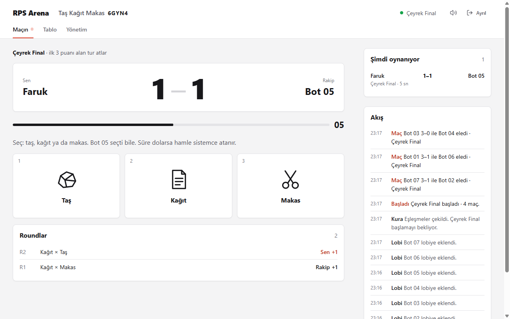
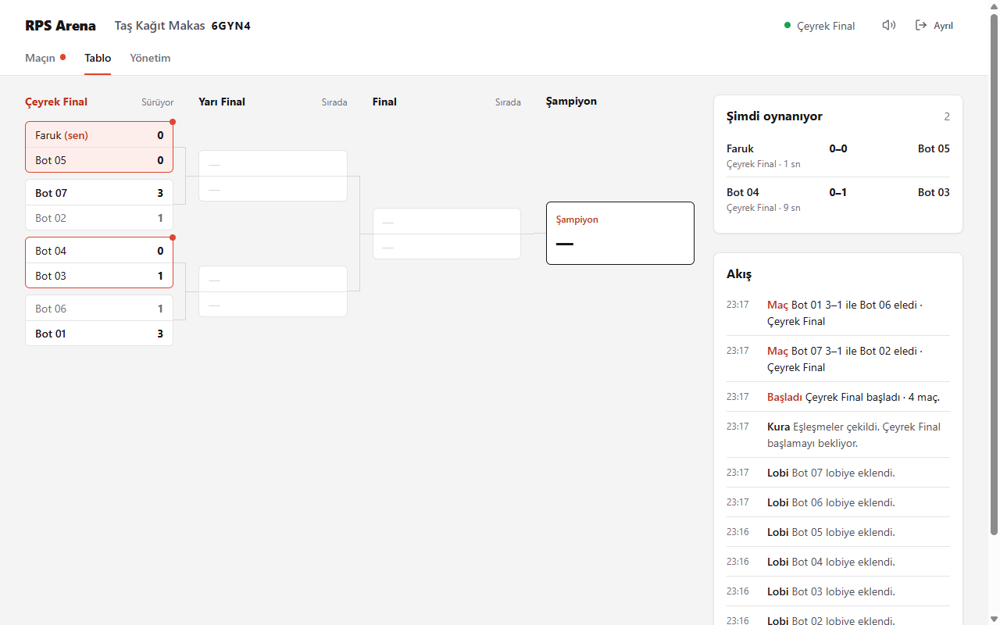

# RPS Arena

Gerçek zamanlı, eleme usulü taş-kağıt-makas turnuvası. React, Node.js ve Socket.io ile yazıldı; tek bir Docker container'ında çalışır.





## Özellikler

- Lobi kurabilir, kodla katılabilir (`/?code=ABC12`) ya da açık bir lobiye rastgele girebilirsiniz. Lobiler en fazla 8 kişilik.
- 2-64 oyuncuyla tek eleme. BYE alan oyuncu her zaman gerçek bir rakiple eşleşir.
- Kurallar ayarlanabilir: 2-5 puana kadar maç, 5-20 sn hamle süresi, 0-5 sn geri sayım, elle ya da otomatik tur geçişi.
- Her round'dan sonra iki oyuncu da sonucu kısa bir arada görür. Süre dolarsa hamleyi sistem atar.
- Yönetici kura çekip bozabilir, turnuvayı başlatıp duraklatabilir, sonraki tura geçebilir, kazanan atayabilir, maçı baştan başlatabilir, oyuncu çıkarabilir ve aynı lobiyle yeni turnuva açabilir.
- 1-2 saniyede hamle yapan test botları, canlı tablo, olay akışı ve podyum var.
- Giriş gerektirmeyen OBS overlay: `/overlay/KOD` (yeşil fon için `?chroma=1`).
- Sekme kapansa bile oyuncu yeniden bağlanır. Yönetici düşerse 30 sn sonra yetki başkasına geçer. `Ayrıl` ile turnuvadan çekilinebilir.
- Durum diske yazılır (`DATA_FILE`). Restart sonrası saatler yeniden kurulur, SIGTERM gelince dosya hemen yazılır. 3 saat boyunca kimsenin girmediği lobiler silinir.

## Hızlı başlangıç (Docker)

```bash
docker compose up -d --build
```

Uygulama [http://localhost:4000](http://localhost:4000) adresinde açılır. Kalıcı veri `tmk-data` volume'ünde, `/data/store.json` dosyasında durur.

## Geliştirme

Node.js 22+ ve npm gerekir.

```bash
npm install
npm run dev
```

| Servis   | URL                   |
|----------|-----------------------|
| Frontend | http://localhost:5173 |
| Backend  | http://localhost:4000 |

```bash
npm run typecheck
npm run self-check   # turnuva akışı, kopma/ayrılma, persist, SEO kaçışları
npm run build
```

## Proje yapısı

```text
backend/src/
  tournament/flow.service.ts      Turnuva akışı: hamle, round saati, faz geçişi, admin komutları
  tournament/match.service.ts     Maç kuralları (saf fonksiyonlar)
  tournament/presence.service.ts  Bağlantı, yönetici devri, restart kurtarma, lobi temizliği
  tournament/timer.service.ts     Tüm sunucu zamanlayıcıları (tek kayıt defteri)
  tournament/tournament.types.ts  Tel formatı — frontend de buradan `import type` eder
  socket/                         İnce Socket.io handler'ları
  state/                          Bellek deposu + disk persist
frontend/src/
  pages/                          Arena (lobi / maç / durum / sonuç), Yönetim, Overlay
  tokens.css, styles.css          Tasarım sistemi
```

## Ortam değişkenleri

Örnek dosya: [`.env.example`](.env.example)

| Değişken          | Açıklama                                  | Varsayılan          |
|-------------------|-------------------------------------------|---------------------|
| `PORT`            | HTTP port                                 | `4000`              |
| `HOST`            | Bind adresi                               | `0.0.0.0`           |
| `SERVE_FRONTEND`  | `1` ise backend `frontend/dist` sunar     | Docker'da `1`       |
| `FRONTEND_ORIGIN` | CORS (`*` gelen Origin'i yansıtır)        | `*` / dev'de Vite   |
| `DATA_FILE`       | Persist dosyası                           | `./data/store.json` |
| `PERSIST`         | `0` ise diske yazmaz                      | açık                |
| `PUBLIC_ORIGIN`   | Canonical / Open Graph origin             | istek başlıkları    |
| `VITE_SOCKET_URL` | Build-time socket URL (boşsa same-origin) | boş                 |

## Tipik turnuva akışı

1. Lobiyi kurun ve kodu paylaşın. Herkes "Hazırım" der.
2. Yönetici "Kurayı çek" ile tabloyu oluşturur ve kontrol eder. Beğenmezse "Kurayı boz" ile geri alır.
3. "Turnuvayı başlat" denince ilk turun bütün maçları aynı anda açılır.
4. Tur bitince yönetici sıradaki turu başlatır. Otomatik geçiş açıksa tur kendiliğinden başlar.
5. Final bitince şampiyon ilan edilir. "Yeni turnuva" aynı kodla lobiyi yeniden açar.

Yöneticinin ekranında her an tek bir "Sıradaki adım" butonu olur. Bu buton Arena sekmesinde de görünür.
